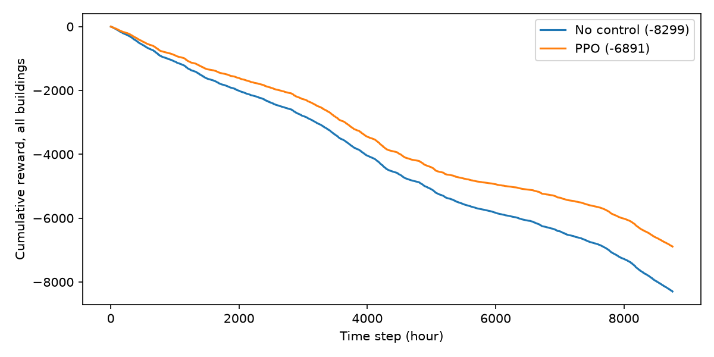

# citylearn-ppo

Multi-agent reinforcement learning for home battery control. One PPO policy, shared by every building, decides when each home battery charges and discharges in the [CityLearn](https://github.com/intelligent-environments-lab/CityLearn) environment, to reduce electricity cost across a district of 5 buildings.

PPO is implemented from scratch in PyTorch.

## Results

Evaluated over one full year (8,760 hourly steps) on `citylearn_challenge_2022_phase_1`. CityLearn reports each KPI relative to a no-control baseline, so values below 1.0 are improvements.

| KPI (district level) | No control | PPO (seed 0) | Change |
|---|---|---|---|
| Electricity cost | 1.000 | 0.822 | -17.8% |
| Carbon emissions | 1.000 | 0.893 | -10.7% |
| Grid electricity consumption | 1.000 | 0.904 | -9.6% |
| Daily peak demand | 1.000 | 0.867 | -13.3% |
| All-time peak demand | 1.000 | 0.922 | -7.8% |
| Ramping | 1.000 | 0.981 | -1.9% |



The policy was trained only on electricity cost, but emissions and peak demand also fell. The batteries store midday solar that would otherwise be exported and release it in the evening, when prices and grid load are high.

## Overview

**Environment.** Each building has rooftop solar, a non-shiftable electrical load and a home battery. Every hour, each building observes 28 values: calendar features, weather with 1 to 3 hour forecasts, solar irradiance, carbon intensity, its own load, solar generation, battery state of charge, and electricity price with forecasts. Its single action sets the battery charge or discharge rate.

**Shared policy (parameter sharing).** One neural network (28 inputs, two hidden layers of 128 ReLU units, 1 output) is applied to every building's local observation. Buildings act differently because their observations differ, but all experience trains the same weights, which makes learning more sample-efficient than training one policy per building.

**Algorithm.** PPO with:
- a Gaussian policy squashed by tanh into the action range, deterministic at evaluation
- a separate value network as a learned baseline
- Generalised Advantage Estimation (gamma 0.95, lambda 0.9)
- reward scaling by a running standard deviation, and advantage normalisation
- clipped surrogate objective (epsilon 0.1), 10 epochs per rollout, gradient clipping

Episodes last a full year, so training uses fixed 2,048-step rollouts and bootstraps the value estimate at each cut-off instead of waiting for episodes to end.

**Reward design.** CityLearn's default reward is negative net electricity consumption. Batteries lose energy on every charge and discharge cycle, so under that reward the optimal policy never uses the battery, and PPO converged to exactly that (all KPIs about 1.00). Replacing it with a cost-based reward, `-(grid import x electricity price)` per building, gives the policy a reason to shift energy in time. That single change produced the results above.

## Setup

Requires Python 3.11.

```bash
git clone https://github.com/elenipsaromatis/citylearn-ppo.git
cd citylearn-ppo
python3 -m venv .venv
source .venv/bin/activate
pip install -r requirements.txt
```

CityLearn downloads the dataset to a local cache on first run.

## Usage

```bash
# Inspect the environment: datasets, buildings, observation and action spaces
python inspect_env.py

# Train (300,000 steps)
python train.py

# Evaluate against the no-control baseline and save the plot
python evaluate.py
```

Hyperparameters live in `PPOConfig` in `src/ppo.py`. The dataset and seed are set at the top of `train.py` and `evaluate.py`.

## Repo structure

```
citylearn-ppo/
├── src/
│   ├── env_utils.py    
│   └── ppo.py          
├── inspect_env.py      
├── train.py            
├── evaluate.py         
├── results/            
└── requirements.txt
```

## Limitations and next steps

- Results are from a single seed. Multi-seed runs are needed to report variance.
- Training and evaluation use the same year of data. Evaluating on unseen buildings (`citylearn_challenge_2022_phase_2` and `phase_3`) would test generalisation.
- The baseline is no control. Comparing against CityLearn's rule-based controllers and published challenge results would place this in context.
- The reward optimises cost only. A weighted reward over cost, emissions and peak demand would let the policy trade them off explicitly.

## Acknowledgements

Environment: CityLearn (MIT license), developed by the Intelligent Environments Lab, University of Texas at Austin.